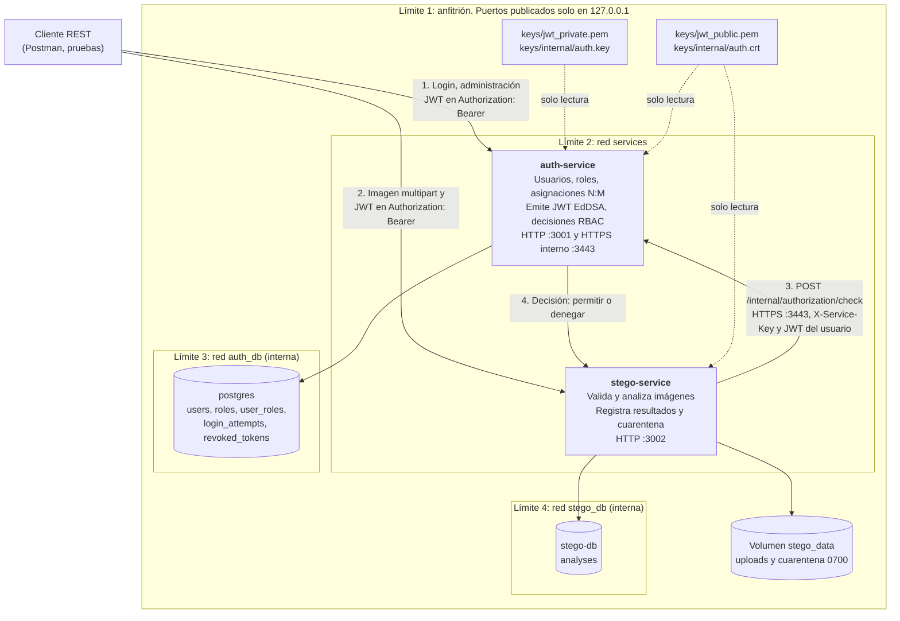

# Arquitectura y límites de confianza

SecureTalk Backend V1 son dos microservicios independientes. Cada uno tiene su proceso, su contenedor, su configuración y su base de datos, y se puede iniciar y detener sin el otro. Las bases de datos y los volúmenes son infraestructura de apoyo, no un tercer servicio.

## Diagrama

Cada recuadro punteado es un límite de confianza: lo que lo cruza se autentica o se valida antes de usarse.

## Responsabilidades

| Componente | Hace | No hace |
|---|---|---|
| `auth-service` | Administra identidades y roles, verifica credenciales con Argon2id, firma JWT y decide la autorización con los roles vigentes en su base de datos | No recibe ni analiza archivos |
| `stego-service` | Verifica el JWT con la llave pública, pide una decisión a AUTH en cada operación, valida y analiza imágenes, guarda resultados y aplica cuarentena | No lee la base de AUTH, no guarda contraseñas, no recibe la llave privada y no acepta permisos enviados por el cliente |
| `postgres` | Persistencia exclusiva de AUTH | Solo lo alcanza `auth-service` |
| `stego-db` | Persistencia exclusiva de STEGO | Solo lo alcanza `stego-service` |

## Límites de confianza

| Límite | Qué lo cruza | Controles |
|---|---|---|
| Cliente → servicios | Credenciales, JWT e imágenes, todo no confiable | Puertos solo en `127.0.0.1`; validación estricta de entradas; límite de peticiones; bloqueo de login; verificación de firma, emisor, audiencia y vigencia del JWT; validación real de archivos antes de analizarlos |
| STEGO → AUTH | JWT del usuario y clave de servicio | HTTPS con TLS 1.2 o superior en un puerto que no se publica; STEGO verifica el certificado de AUTH; `X-Service-Key` comparada en tiempo constante; sin decisión verificable, STEGO responde 503 sin procesar el archivo |
| Servicio → su base de datos | Consultas y credenciales propias | Una red interna por base, sin salida al anfitrión; cada servicio solo pertenece a la red de su base |
| STEGO → disco | Archivos recibidos | Nombre aleatorio en disco; carpetas `0700`; archivo en cuarentena `0400`, sin ejecución y sin rutas estáticas |
| Anfitrión → contenedores | Llaves y certificado | Montados en solo lectura; AUTH recibe la llave privada y STEGO únicamente las partes públicas; `keys/` y `.env` no se versionan |

## Flujo de una operación protegida

1. El cliente inicia sesión en AUTH y recibe un JWT firmado con EdDSA, sin roles.
2. El cliente envía la imagen a STEGO con ese JWT.
3. STEGO verifica el JWT con la llave pública. Si no es válido, responde 401.
4. STEGO pide a AUTH una decisión para esa acción y, si aplica, ese recurso. AUTH revisa el token, el estado del usuario y sus roles en la base de datos.
5. Si AUTH deniega, STEGO responde 403. Si AUTH no responde o la respuesta no es válida, responde 503. En ambos casos no procesa el archivo.
6. Si AUTH permite, STEGO valida el archivo, lo analiza, registra el resultado y aplica la política: `ninguna`, `advertencia`, `cuarentena` o `rechazo`.

Ninguna decisión se reutiliza: al retirar un rol, la siguiente operación con el mismo JWT queda denegada. Esto aplica Zero Trust y Secure by Design, como se detalla en la [matriz de riesgos](riesgos.md).

## Documentos relacionados

- [Contrato AUTH-STEGO](contrato-auth-stego.md)
- [Autenticación JWT y RBAC](autenticacion-rbac.md)
- [Modelo de datos](modelo-datos.md)
