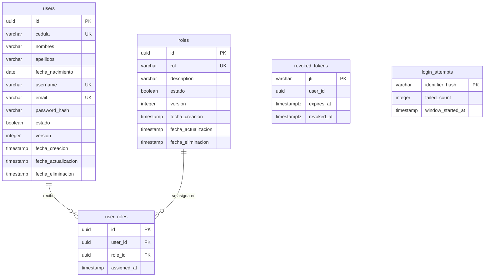

# Modelo de datos de AUTH

Estas tablas pertenecen solo a AUTH. STEGO no puede alcanzar esta base de datos: en Docker, solo `auth-service` está en su red. El esquema cambia únicamente mediante migraciones.

## Diagrama entidad-relación

## Relación N:M

`user_roles` es la tabla asociativa: un usuario puede tener varios roles y un rol puede estar en varios usuarios.

- **Claves foráneas:** `user_id` apunta a `users` y `role_id` a `roles`.
- **Unicidad:** `UNIQUE(user_id, role_id)` impide una asignación repetida, incluso con peticiones simultáneas. La API responde 409 sin crear otra fila.
- **Identidad propia:** cada asignación tiene su `id`, que es el que usa `DELETE /api/user-roles/:id`, y su fecha en `assigned_at`.

## Equivalencia con el Anexo A

| Anexo A | Este modelo |
|---|---|
| `status` | `estado` |
| `created_at`, `updated_at` | `fecha_creacion`, `fecha_actualizacion` |
| `roles.name` | `roles.rol` |

Además de lo que pide el anexo, `users` guarda los datos personales con la cédula ecuatoriana validada por la API, y ambas entidades tienen `version` y `fecha_eliminacion`.

## Tablas de apoyo

No participan en la relación N:M y no tienen claves foráneas:

| Tabla | Para qué sirve |
|---|---|
| `revoked_tokens` | Tokens revocados por logout. Solo guarda el `jti`, nunca el JWT |
| `login_attempts` | Contador de fallos de login. Guarda un hash SHA-256 del identificador, no lo que se escribió |

## Borrado

Usuarios y roles no se borran físicamente: se desactivan con `estado=false`. Una asignación sí se elimina al retirar el rol.
